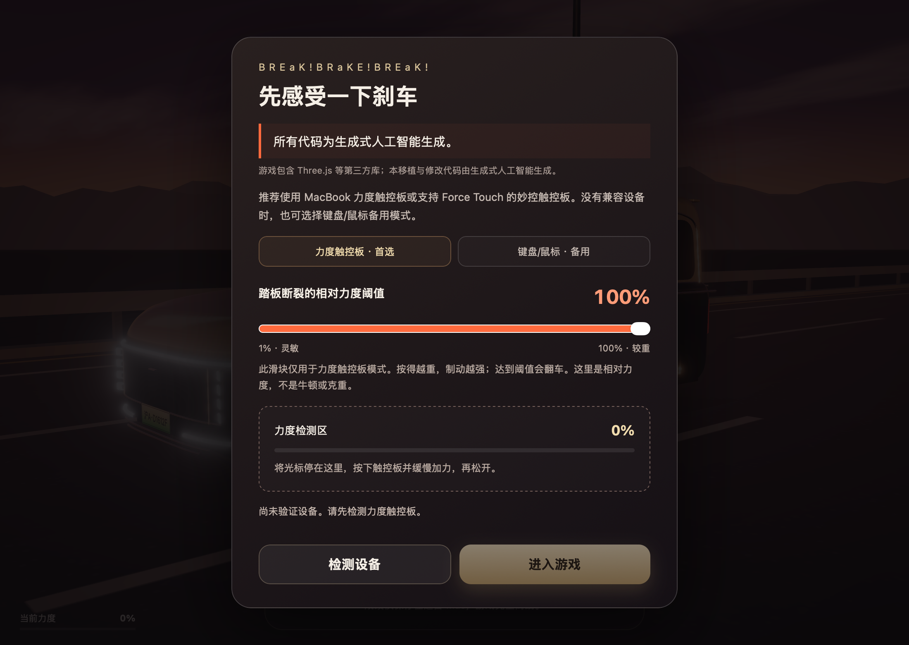

# 本项目完全由生成式人工智能对 [breaking.de5.net](https://breaking.de5.net/) 和 [breakbreak.app](https://breakbreak.app/) 进行触控板操作移植

## BREaK!BRaKE!BREaK!

macOS 离线刹车小游戏。用 MacBook 力度触控板或支持 Force Touch 的妙控触控板控制制动：按得越重，刹车越强；超过设定的力度阈值，踏板就会断裂。

本次 macOS 移植与修改由生成式人工智能完成。可构建基线来自网页已发布的前端文件；原游戏与第三方库的来源说明见 [THIRD_PARTY_NOTICES.md](THIRD_PARTY_NOTICES.md)。


## 下载与安装

要求 **macOS 13 或更高**，支持 Apple Silicon 与 Intel Mac。

| 下载 | 适用设备 |
| --- | --- |
| [Universal 通用版（推荐）](https://github.com/IOStreamReader/BREaKBRaKEBREaK/releases/latest/download/BREaKBRaKEBREaK-Universal.zip) | Apple Silicon 与 Intel |
| [arm64 版](https://github.com/IOStreamReader/BREaKBRaKEBREaK/releases/latest/download/BREaKBRaKEBREaK-arm64.zip) | Apple Silicon |
| [Intel x86_64 版](https://github.com/IOStreamReader/BREaKBRaKEBREaK/releases/latest/download/BREaKBRaKEBREaK-Intel.zip) | Intel Mac |
| [SHA-256 校验文件](https://github.com/IOStreamReader/BREaKBRaKEBREaK/releases/latest/download/SHA256SUMS.txt) | 验证下载包 |

解压后，将 App 放入“应用程序”并打开。发布包使用本地 ad-hoc 签名，未经 Developer ID 签名或 Apple 公证。如果 macOS 阻止运行，请在确认来源后通过“系统设置 → 隐私与安全性”允许打开；无需关闭系统安全功能。

## 怎么玩

1. 启动后选择“力度触控板 · 首选”，点击“检测设备”。将光标停在检测区，按下触控板，缓慢加力，再松开。
2. 调节踏板断裂的相对力度阈值：**1～100%，默认 100%**。阈值越低，越容易踩断；设置会自动保存。
3. 进入游戏并开始挑战。车辆自动加速，车速达到 **100 km/h** 后才能制动。
4. 将光标停在游戏画面内，按压触控板刹车，松手立即释放制动力。得分为刹车初速度² ÷ 刹停用时。
5. 刹停成功后输入昵称，将成绩保存到本机排行榜。

Apple 提供的是相对力度，百分比不代表真实牛顿或克重。鼠标点击不会被当作真实力度信号。

没有检测到兼容硬件时，程序会弹窗提醒“无法获得完整体验”。确认后可使用**键盘/鼠标备用模式**：按住空格、游戏画面上的鼠标左键或右下角刹车按钮，沿用原游戏持续按住逐渐加力、松开逐渐卸力的玩法。也可直接在启动弹窗选择备用模式。该模式不使用相对力度滑块。

切换 App、窗口失焦或最小化会暂停游戏和音频。返回后需重新按压或按键。应用菜单中的“力度设置…”可切换操控方式；进行中的挑战会返回主菜单。

<details>
<summary>查看启动设置界面</summary>



</details>

## 离线成绩

游戏没有在线排行榜或其他在线功能。昵称、阈值和成绩以 JSON 保存到本机；排行榜展示每个昵称的最高分，全部已保存记录仍会保留。升级或重新编译不会主动清除成绩。

应用菜单的“查看本地成绩文件”可以定位数据文件。沙盒环境下通常位于：

```text
~/Library/Containers/net.breakgame.forcebrake/Data/Library/Application Support/BREaK-BRaKE-BREaK/state.json
```

从旧版升级时，原有 50% 设置会更新为 100%，其他阈值和成绩保留。新版中重新选择的 50% 会正常保存。

## 从源码构建

需要 macOS、Apple Command Line Tools 和 Python 3。无需下载前端依赖或安装完整 Xcode。

```sh
git clone https://github.com/IOStreamReader/BREaKBRaKEBREaK.git
cd BREaKBRaKEBREaK
python3 scripts/build.py
```

生成的 App、三种架构的 ZIP 和 `SHA256SUMS.txt` 位于 `dist/`。`build/` 保存构建中间文件；这两个目录不提交到仓库，安装包仅在 [Releases](https://github.com/IOStreamReader/BREaKBRaKEBREaK/releases) 提供。

运行自动测试另需 Node.js 18 或更高：

```sh
python3 scripts/test.py
```

已在 Apple Silicon Mac 上验证原生游戏运行，并通过 Rosetta 验证 Intel x86_64 程序；尚未在实体 Intel Mac 上实测。架构、验证范围和项目文件说明见 [开发说明](docs/DEVELOPMENT.md)。

## 权利声明

本次移植与修改的可处分权利采用 [Unlicense](LICENSE) 放弃，可以自由使用、修改和分发。原游戏及第三方库的权利和许可保留，范围见 [LICENSING.md](LICENSING.md) 与 [第三方说明](THIRD_PARTY_NOTICES.md)。

---

<sub>项目名字来自于 BREaK!BREaK!BREaK!。之所以选这个名字，是因为三个 v800 的 brake 全 break 了。</sub>
